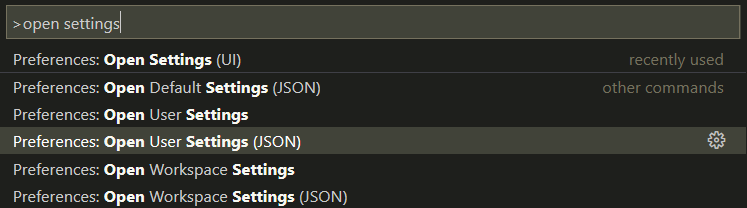
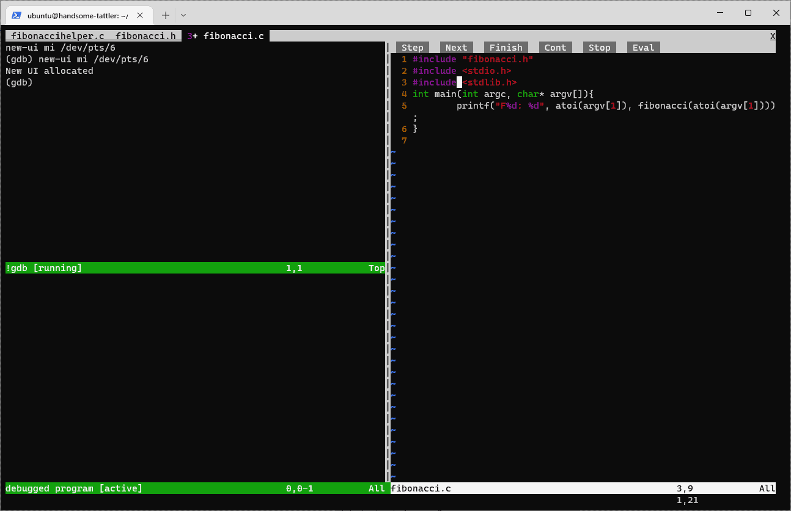
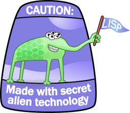

# -*- org-confirm-babel-evaluate: nil -*-
#+options: ':nil *:t -:t ::t <:t H:3 \n:nil ^:t arch:headline
#+options: author:t broken-links:nil c:nil creator:nil
#+options: d:(not "LOGBOOK") date:t e:t email:nil expand-links:t f:t
#+options: inline:t num:t p:nil pri:nil prop:nil stat:t tags:t
#+options: tasks:t tex:t timestamp:t title:t toc:t todo:t |:t
#+title: Przeciętne edytory tekstu i Emacs
#+subtitle: konfiguracja, wtyczki i ergonomia
#+date: <2026-11-16 pon>
#+author: kpm
#+email: kpm@lp0.pl
#+language: pl
#+select_tags: export
#+exclude_tags: noexport
#+creator: Emacs 30.2 (Org mode 9.7.11)
#+cite_export:
#+OPTIONS: H:2
#+startup: beamer
#+latex_class: beamer
#+beamer_theme: Madrid
#+latex_header: \usepackage{tabularx,tikz}
#+latex_header: \usetikzlibrary{arrows.meta,decorations,decorations.pathreplacing}

* Wstęp
** Edytor tekstu a IDE
- *Edytor tekstu*: lekki, uniwersalny, rozbudowywany wtyczkami
- *IDE*: zintegrowane środowisko dla jednego języka/ekosystemu (IntelliJ, Visual Studio, Borland TurboXYZ, Delphi)

* Co mają wspólnego vscode, (neo)vim i Emacs
** Wspólna architektura
- Mały rdzeń + system rozszerzeń
- Konfiguracja jest /kodem lub danymi/, a nie klikaniem w menu
- Wszystko da się przypisać do skrótu klawiszowego
- Rozszerzenia dodają:
  - języki i podświetlanie składni
  - integracje (git, terminal, debugger)
  - nowe interfejsy (wyszukiwanie, paleta poleceń)

** Porównanie
#+attr_latex: :environment tabularx :width \textwidth :align lXXX :font \footnotesize
|                      | *vscode*    | *Neovim*                                       | *Emacs*                             |
|----------------------+---------------+----------------------------------------------+-----------------------------------|
| Plik konfiguracji    | ~settings.json~ | ~init.lua~ lub ~.vimrc~                          | ~.emacs~ lub ~init.el~                |
|----------------------+---------------+----------------------------------------------+-----------------------------------|
| Język rozszerzeń     | typescript    | lua / vimscript / vim9script                 | Emacs Lisp                        |
|----------------------+---------------+----------------------------------------------+-----------------------------------|
| Repozytorium wtyczek | Marketplace   | menadżer wtyczek: vim-plug, vundle, vim pack | ELPA, package.el                  |
|----------------------+---------------+----------------------------------------------+-----------------------------------|
| Sposób edycji tekstu | zwykły        | modalny                                      | do wyboru, do koloru (stary żart) |
|----------------------+---------------+----------------------------------------------+-----------------------------------|
| Paleta poleceń       | ~Ctrl+Shift+P~  | ~Esc : TAB~                                    | ~M-x~                               |

* Konfiguracja
**  Globalna (i per użytkownik): nawyki, skróty, koloryt (motyw),
- vscode: raczej wyklikiwane w gui, ale plik konfiguracyjny to =~/.config/Code/User/settings.json=
- (neo)vim: =/etc/vimrc=, =~/.vimrc=, =~/.vim/pack=
- emacs: =~/.emacs=, =~/.emacs.d/init.el=, inne pliki elispa, ładowane raczej z podfolderów pod =~/.emacs.d/=
**  Projektowa/per plik:
*** vscode: =projekt/.vscode/settings.json=
    + ~Ctrl-Shift-P~,
#+attr_latex: :height 80.0
            
**  Projektowa/per plik:
***  (neo)vim:
- autocmd w =.vimrc=
- osobne wtyczki
- modeline
  #+BEGIN_SRC c
/* vim: set ts=4 sw=4: */
  #+END_SRC
  + ai = autoindent
  + ts = tabstop
  + sw = shiftwidth =<<=, =>>=
**  Projektowa/per plik:
*** Emacs:
- =.dir-locals.el=
- file variables
  + ~-*- mode: modename; var1: value1; ... -*-~
  + ~-*- Modename -*-~
  + Local Variables
    #+BEGIN_SRC elisp
;; Local Variables:
;; mode: modename
;; var1: value1
;; End:
    #+END_SRC

** *Per język/tryb: inne wcięcia dla różnych języków
*** vscode
do wyklikania
** *Per język/tryb: inne wcięcia dla różnych języków
*** (neo)vim
- autocmd w =.vimrc=
  #+BEGIN_SRC vim
autocmd FileType python,lua set
    \ shiftwidth=2 softtabstop=2
autocmd FileType go,make set
    \ noexpandtab
    \ shiftwidth=8
    \ softtabstop=0
   #+END_SRC
** Per język/tryb: inne wcięcia dla różnych języków
*** Emacs
Zwykle zdefiinowane rozsądnie przez tryb (mode) edycji. Zmienialne przez zmienne trybu.
#+BEGIN_SRC elisp
(setf c-basic-offset 2)
(setf python-indent-offset 2)
;; W make-mode.el, w definicji trybu edycji:
(setq indent-tabs-mode t)
#+END_SRC

** Wspólnie =.editorconfig= - działa w prawie każdym edytorze
[[https://editorconfig.org/][Editorconfig]] pozwala ujednolicić projektową konfigurację edytora/IDE. Gdy $N$ osób pracuje nad $1$ projektem,
dobrze by zachowali w miarę ten sam styl pisania kodu.

#+BEGIN_SRC editorconfig
  root = true

  [*]
  end_of_line = lf

  [*.py]
  indent_style = space
  indent_size = 2

  [Makefile]
  indent_style = tab
#+END_SRC

** Dobre praktyki konfiguracji
- trzymanie konfiguracji w repo / [[https://kelp.krzysckh.org][synchronizowanej gdzieś online]]
- dodawanie zmian pojedynczo, nie bzdurne przeklejanie z SO / LLMów
- komentowanie wszystkiego
  + najpopularniejsze edyotry tekstu *nie* wspierają czytelnych języków do konfiguracji (ts/js/json, vimscript, lua)
- cudze gotowe konfiguracje są okej, ale to trochę jakby zainstalować IDE, a nie prygotować edytor pod siebie
  + vim
    - [[https://www.lazyvim.org/][lazyvim]]
    - [[https://nvchad.com/][nvchad]]
    - lunarvim
  + emacs
    - [[https://raw.githubusercontent.com/doomemacs/core/screenshots/main.png][doom]]
    - [[https://www.spacemacs.org/][spacemacs]]
    - ...
- pilnować, żeby edytor startował szybko (opcjonalne)

* Wtyczki
** ekosystem
- menedżer pakietów: instaluje wtyczki i zależności, aktualizuje, blokuje wersje
- bezpieczeństwo: wtyczka to *cudzy kod* z pełnym dostępem do plików
  - *ważne*: sprawdzenie autora / dostępność w repo (vscode marketplace / melpa / GNU elpa - niemożliwe z wtyczkami (neo)vima),
    popularność, aktywność projektu
- wtyczki ładowane /leniwie/ (dopiero gdy potrzebne) przyspieszają start
  - ciężkie do utrzymywania w edytorach mniej real-time niż Emacs

** najczęściej instalowane wtyczki
- uzupełnianie i wyszukiwanie (fuzzy finding - głównie w vimie i emacsie - vscode jest nie do odratowania - /ma całkiem dobrą builtin szukajkę/)
- klient LSP + serwery np. =clangd=, =gopls=, =haskell-language-server=
- drzewa składniowe (tree-sitter) - międzyedytorowa definicja składni języka
- Integracja z git (emacs: magit, vim: fugitive, vscode: wbudowane)
- snippety, formatowanie, linting
- motyw i pasek stanu (dla tych, co nie mają co robić z czasem)
- notatki / zarządzanie zadaniami (w Emacsie np.: org mode / denote, w vimie vimwiki)
- debuggery

** PRZERWA: LSP
*LSP - language server protocol*

\begin{figure}
\begin{tikzpicture}
  \draw[arrows=-Stealth] (0.94,2.93) -- (0.94,3.56);
  \draw[arrows=-Stealth] (1.17,3.6) -- (1.17,2.95);
  \node[draw] at (1.06,3.88) {serwer języka};
  \node[draw] at (1.04,2.66) {edytor tekstu};
  \node[draw, shape=ellipse] at (4.8,2.66) {użytkownik};
  \draw[arrows=-Latex] (2.2,2.8) -- (3.48,2.8);
  \draw[arrows=-Latex] (3.48,2.51) -- (2.2,2.51);
  \node at (1.84,3.27) {LSP};
\draw [decorate,decoration={brace,amplitude=5pt,mirror,raise=4ex}, rotate=270]
  (-3.6,0.39) -- (-3,0.39);
  \node[draw] at (-3.5,3.31) {sieć lokalna / internet / unix socket};
\end{tikzpicture}
\end{figure}

** koniec przerwy

** najczęściej instalowane wtyczki
- uzupełnianie i wyszukiwanie (fuzzy finding - głównie w vimie i emacsie - vscode jest nie do odratowania - /ma całkiem dobrą builtin szukajkę/)
- klient LSP + serwery np. =clangd=, =gopls=, =haskell-language-server=
- drzewa składniowe (tree-sitter) - międzyedytorowa definicja składni języka
- Integracja z git (emacs: magit, vim: fugitive, vscode: wbudowane)
- snippety, formatowanie, linting
- motyw i pasek stanu (dla tych, co nie mają co robić z czasem)
- notatki / zarządzanie zadaniami (w Emacsie np.: org mode / denote, w vimie vimwiki)
- debuggery

** Debuggery
*** vim
vim to na tyle lekki edytor, że ludzie zwykle korzystają z zewnętrzych debuggerów - frontendów do gdb, lldb
lub innych, bardziej skupionych na danym języku. Jednak:

** Debuggery
*** emacs
- wbudowana ścisła integracja z gdb (prezentacja praktyczna)
- obsługa DAP

** Debuggery
*** vscode
- obsługa debuggerów dzięki rozszerzeniom
- [[https://code.visualstudio.com/docs/debugtest/debugging][udokumentowane wspólne api debugowania kodu]]
- wygląd jak w każdym IDE (całkiem zgrabny)

** zdalne edytowanie i terminal
- Wbudowany terminal i powłoka
  - vscode: do wyklikania w menu terminal
  - (neo)vim: =:term= (od całkiem niedawna - wcześniej wymagana była wtyczka)
  - emacs: =M-x ansi-term RET=, =M-x eshell RET=, =M-x shell RET=, =M-x compile RET=, =M-x shell-command RET=, ...
- Praca na serwerze, w kontenerze, ...
  - vscode: pełne wsparcie do otwierania folderów przez ssh
  - (neo)vim: najczęściej uruchamiane po prostu w terminalu przez ssh
  - Emacs: TRAMP
** TRAMP
- tryb tramp w emacsie pozwala na korzystanie ze zdalnych środowisk przez różne protokoły i wspólne menu -
  dokładnie to samo, co wyświetlałoby się na lokalnej maszynie. Dzięki temu nawet nie zauważamy, że korzystamy ze zdalnych zasobów.
  + ftp
  + ssh
  + sudo
  + telnet
  + smb
  + rsync
  + podman
  + docker
  + google drive
  + ...
- prezentacja jeśli czas i sieć pozwoli

* EMACS
** EMACS
#+BEGIN_QUOTE
eight megabytes and constantly swapping
#+END_QUOTE

#+BEGIN_CENTER
#+attr_latex: :height 90

#+END_CENTER

** po krótce
- emacs to interpreter Emacs Lispa z edytorem tekstu na wierzchu
- praktycznie wszystko jest funkcją, którą można wywołać, zmienić albo zastąpić (zastąpianie =car= to największy błąd jaki możecie uczynić w jakimkolwiek środowisku lispowym)
  #+BEGIN_SRC lisp
(set 'car 'cdr)
  #+END_SRC
- zmienne i funkcje są /samodokumentujące się/ - całe środowisko jest napisane w lispie* i każda** funkcja/zmienna ma opis
- cała konfiguracja użytkownika jest pisana w emacs lispie

** podstawy lispa-2
- nie zagłębiamy się w *-2* w *lisp-2*
- części składni
  + atom : /cokolwiek/
  + para : (/cokolwiek/ lub para . /cokolwiek/ lub para)
  + lista : para, z =nil= em jako ostatnie /cokolwiek/
  + funkcja : lista, którą można wy =eval= uować (z podmienionymi argumentami na atomy), zwracająca atom
- wygląd składni (notacja polska)
    #+BEGIN_SRC elisp
      (+ 10 10)        ;;=> 20
      (concat "a" "b") ;;=> "ab"
      (defun f (a b)
        (+ a b))       ;;=> 'f
      (f 30 12)        ;;=> 42
    #+END_SRC
- =kebab-case=
  dla-długich-nazw-symboli

** Menedżer pakietów i MELPA
#+BEGIN_SRC
  M-: (require 'package) RET
  M-x package-install RET nazwa-paczki RET
#+END_SRC

** przykład z wcześniej - git i kontrola wersji
magit - prezentacja praktyczna

** przykład z wcześniej - edycja zdalna
tramp - prezentacja praktyczna

** org mode i babel - jupyter notebookesque kod w doumentach
- ta prezentacja jest napisana w org mode i eksportowana do Beamera (=C-c C-e l P=)
- org babel wykonuje bloki kodu w wielu językach i wkleja wynik do dokumentu
- dzięki babelowi można żąglować danymi między językami

** babel i org mode - przykład
#+NAME: liczby
#+BEGIN_SRC elisp :exports both
  (mapcar #'1+ (number-sequence 1 5))
#+END_SRC

#+RESULTS: liczby
| 2 | 3 | 4 | 5 | 6 |

** babel - łączenie języków
#+NAME: tab
#+BEGIN_SRC elisp :exports both
  `(,(number-sequence 1 3)
    ,(number-sequence 4 6))
#+END_SRC

#+RESULTS: tab
| 1 | 2 | 3 |
| 4 | 5 | 6 |

#+NAME: tab2
#+BEGIN_SRC python :exports both :var t=tab
  return [[x * 2 for x in row] for row in t]
#+END_SRC

#+RESULTS: tab2
| 2 |  4 |  6 |
| 8 | 10 | 12 |

** babel - łączenie większej ilości języków
#+NAME: tab3
#+BEGIN_SRC haskell :exports both :var t=tab2
  map (map (* 2)) t
#+END_SRC

#+RESULTS: tab3
|  4 |  8 | 12 |
| 16 | 20 | 24 |

#+BEGIN_SRC js :exports both :var t=tab3
  return t.map(l => l.map(x => x*2))
#+END_SRC

#+RESULTS:
|  8 | 16 | 24 |
| 32 | 40 | 48 |

* Podsumowanie
** epilog
- wszystkie edytory: mały rdzeń + wtyczki + konfiguracja jako kod
- funkcje "IDE" są z wtyczek, nie samego edytora
- nie warto przesadzać z konfiguracją (hipokryzja)
- wojny edytorowe były /cool/ zanim się urodziliśmy. teraz już nie warto

** dziękuję
pytania?
